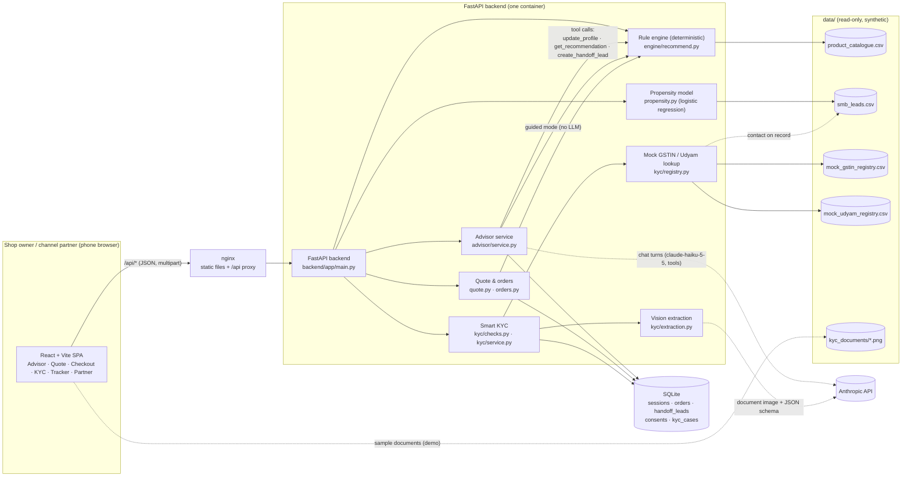
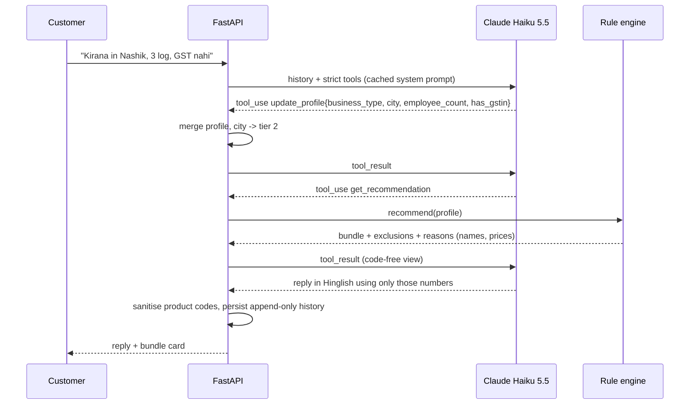
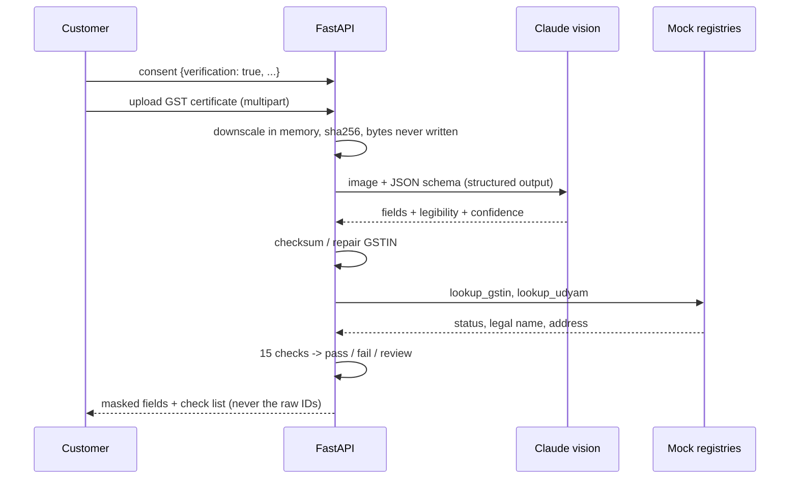

# Architecture: Project Udyam Digital (Accel Business prototype)

A mobile-first web app with one Python backend. The LLM is used in exactly two places and never decides
anything about products, prices or eligibility.

## Components and data flows



## What each part does

| Part | Responsibility | Deterministic? |
| --- | --- | --- |
| Rule engine (`engine/`) | Eligibility (tier, size, GSTIN, dependencies), bundle per segment, quantities, pricing, reasons | Yes, pure Python, 108 unit tests incl. replay of all 368 real bundles |
| Advisor (`advisor/`) | Talks to the customer in their language and extracts a structured profile through strict tools. Guided (tap) mode does the same without a model. | Model only for language; recommendations always from the engine |
| Quote & orders | Re-prices every line server-side from the catalogue, mock payment, order timeline from install days | Yes |
| Smart KYC (`kyc/`) | Consent record, field extraction, 15 validation checks, masked results, retention | Extraction uses the model; every check is deterministic |
| Propensity (`propensity.py`) | Ranks leads to call, trained on a stratified split, reports held-out metrics and top factors | Yes, seeded |
| Partner views | Handoff leads by territory, lead priority list, assisted mode | Yes |

## Key sequences

### One advisor turn (chat mode)



### One KYC document



## Runtime

- `docker compose up` starts two containers: `backend` (uvicorn, port 8000) and `frontend` (nginx, port 3000).
- `data/` is mounted read-only into the backend; the SQLite file lives in a named volume.
- `ANTHROPIC_API_KEY` is read from `.env`. Without it the app runs with the guided advisor and the sample KYC documents.
- Models default to `claude-haiku-5-5` (`ADVISOR_MODEL`, `KYC_MODEL` override).

## Code map

```
backend/app/engine/        models.py · catalogue.py · rules.py · recommend.py
backend/app/advisor/       prompts.py · tools.py · service.py
backend/app/kyc/           validators.py · registry.py · checks.py · extraction.py · service.py · specimens.py
backend/app/               quote.py · orders.py · propensity.py · seed.py · db.py · main.py
backend/tests/             160 tests; advisor_scenarios/ (25 live scenarios); fixtures/kyc_golden.json
backend/scripts/           run_kyc_specimens.py
frontend/src/pages/        Home · Advisor · Quote · Checkout · Kyc · Track · Partner
frontend/src/components/   BundleCard · GuidedAdvisor
analysis/explore_data.py   generates docs/data_findings.md
```
